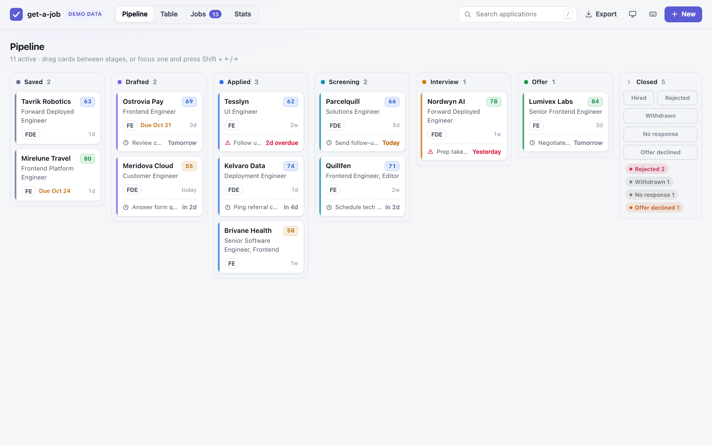
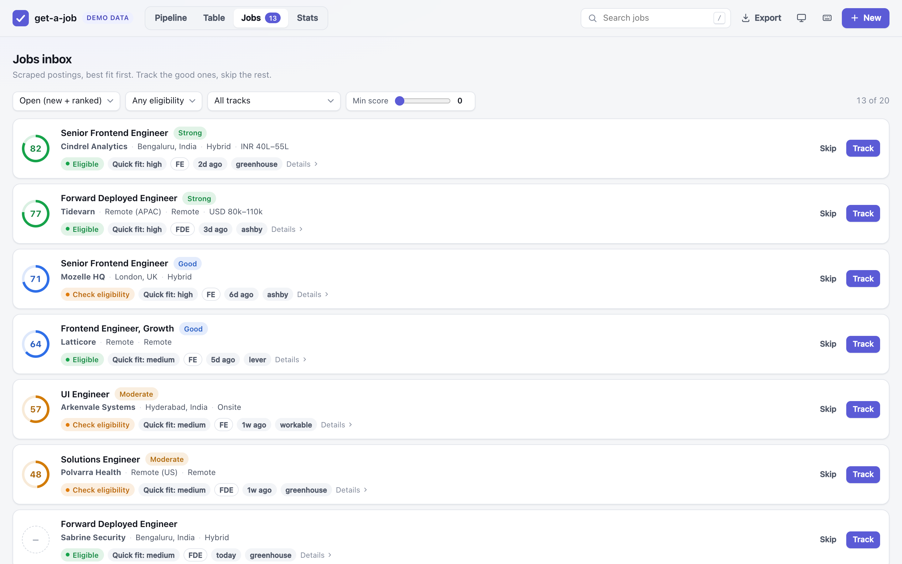
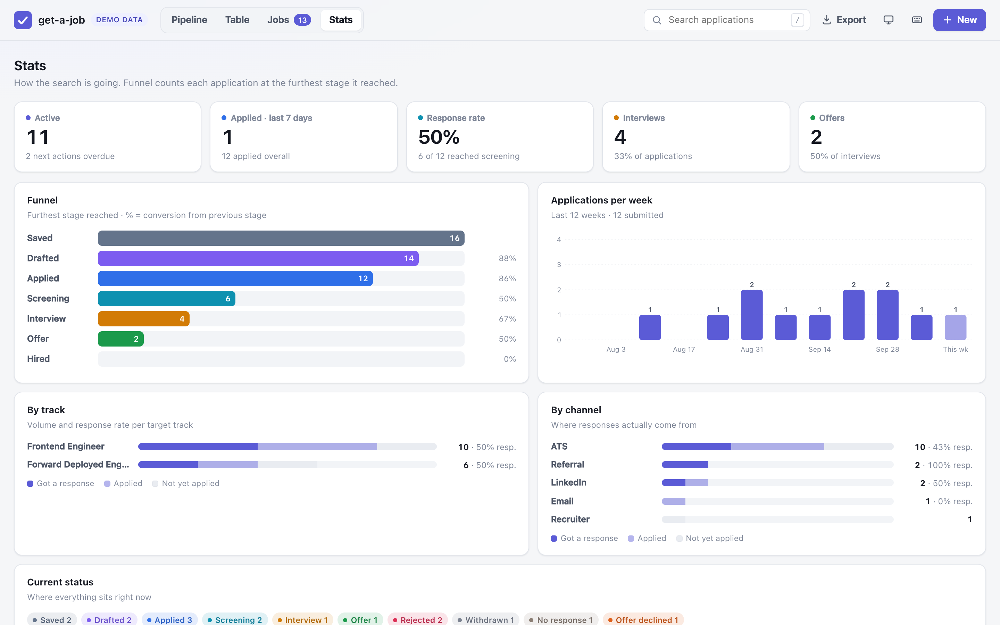
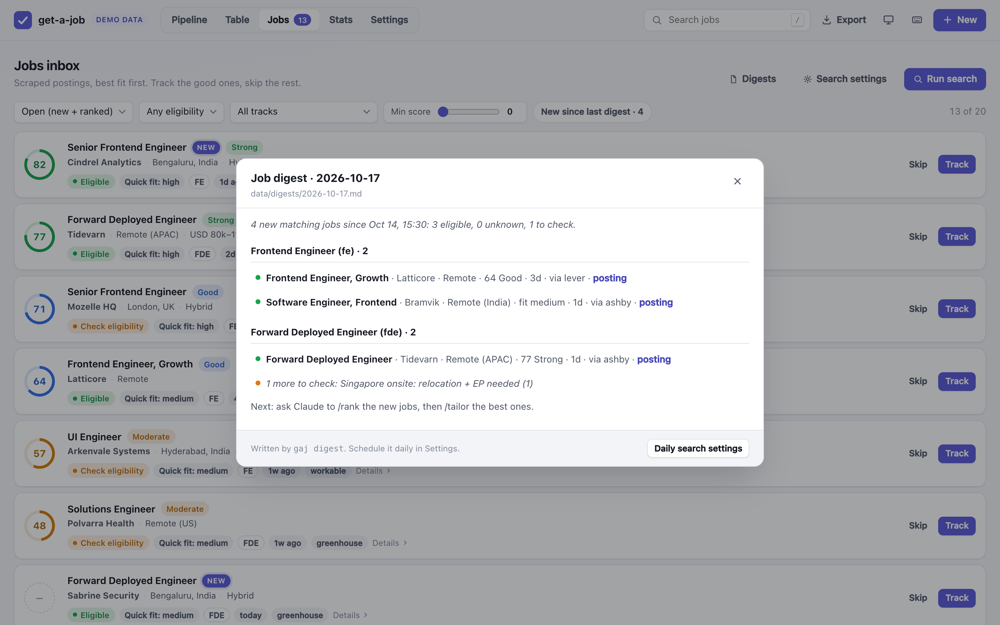
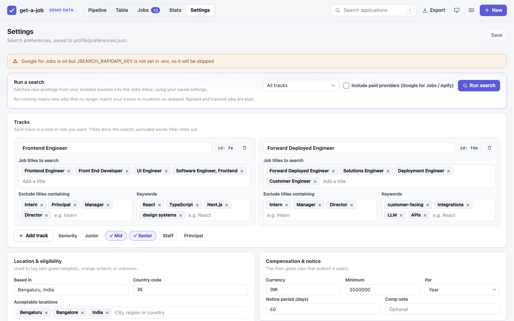
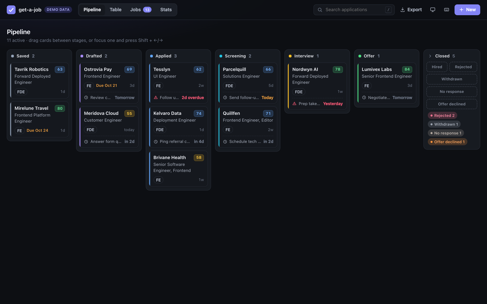
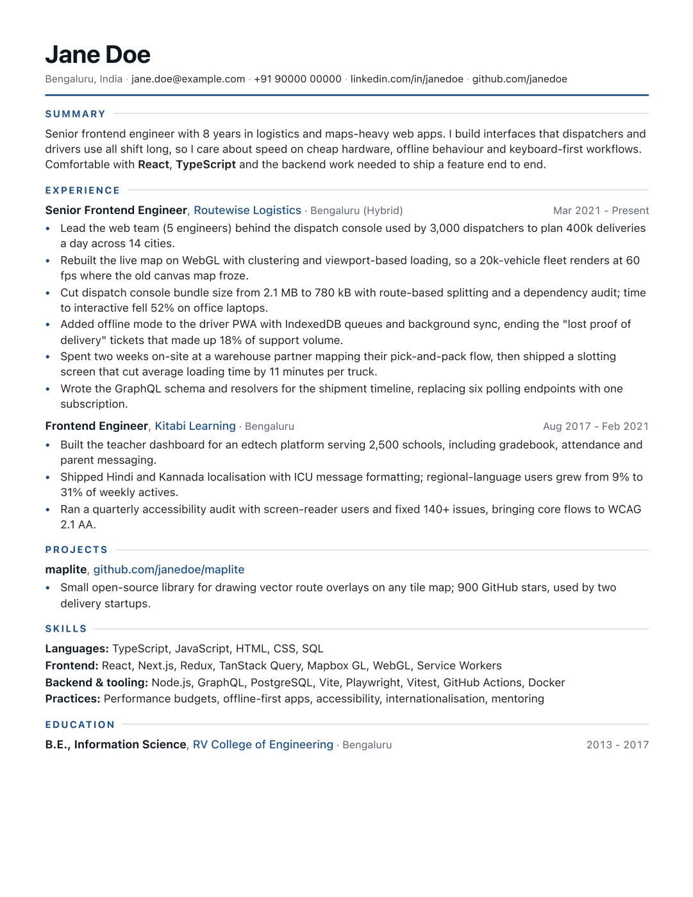

# get-a-job

A local-first job search framework that runs inside [Claude Code](https://claude.com/claude-code): onboarding, a tailorable `resume.md`, job scraping from free public sources, honest per-job tailoring, and a local tracker that exports to Google Sheets.

[](https://github.com/harshagarwal08/get-a-job/actions/workflows/ci.yml)




<table>
  <tr>
    <td width="50%"></td>
    <td width="50%"></td>
  </tr>
  <tr>
    <td align="center"><sub>Jobs inbox: fit score, eligibility, track</sub></td>
    <td align="center"><sub>Stats: funnel, weekly volume, response rates</sub></td>
  </tr>
</table>

<sub>All screenshots use the built-in demo data (`npm run tracker -- --demo`); every company and person in it is fictional.</sub>

## Why

- **Local-first.** Your profile, resume, scraped jobs and tracker live as plain files on your machine. The tracker is a local web page on `127.0.0.1`. Nothing is uploaded unless you run `/export-sheets`.
- **Private by default.** Everything personal is gitignored, and CI fails if those rules are weakened. You can fork the public repo and run your search in it.
- **Honest tailoring.** Every claim in a tailored resume must trace back to `profile/profile.md`, your confirmed facts. A separate reviewer pass and a grounding audit remove anything invented. Metrics are never made up.
- **Free by default.** Jobs come from companies' public ATS feeds and careers pages, free job boards (Hacker News "Who is hiring?", Arbeitnow, Remotive, Remote OK), and your own LinkedIn alert emails. Paid providers (Google for Jobs, Apify) are optional, use your own key, and have spending caps.
- **Mechanical work stays deterministic.** Fetching, de-duplicating, PDF rendering, page-count checks and the tracker are plain Node code (`gaj`). Claude does the judgment work: interviewing you, scoring fit, drafting and reviewing.

## How to use it (start to finish)

You talk to Claude in a terminal; it runs the steps for you. Commands starting with `/` are typed inside Claude Code.

**1. Install.** You need Node.js 20+ and [Claude Code](https://claude.com/claude-code). In the project folder:

```bash
npm install
git config core.hooksPath .githooks   # stops you from committing personal files by accident
claude                                # opens Claude Code in this folder
```

**2. Set up your profile.** Put your old CV (PDF, Word, or text) in the `inbox/` folder, then run `/onboard`. Claude asks about the roles, places and pay you want, reads your CV, and creates your preferences, a facts file about you, a master resume, and a list of companies to watch. These files live in `profile/` and `config/` on your computer and are never committed or uploaded.

```
/onboard
```

Change your mind later with `/preferences` ("add Remote EU", "exclude Staff titles") or the tracker's **Settings** tab.

**3. Optional: add API keys for extra sources.** The free sources are enough to start. If you want Google for Jobs or Apify too, copy the template and paste your keys into it yourself (never into the chat). Paid sources only run when you allow it (`/scrape` asks once per session) and stop at a monthly budget.

```bash
cp .env.example .env
```

**4. Find jobs.** `/scrape` collects matching jobs from all your enabled sources. Each job gets a tag: 🟢 you can likely work there (location and work permit fit), 🟠 probably not without a visa or relocation (the reason is shown), ⚪ the posting doesn't say enough to tell.

```
/scrape                     # free sources; say yes to the paid ones when asked, if you set them up
/email-alerts               # jobs from your LinkedIn, Naukri, Indeed, Wellfound, Instahyre, Cutshort, Glassdoor alert emails (read-only Gmail)
/import-jobs                # paste results from any job site you browsed yourself
/discover AI startups in London   # find more companies to watch
/funded                     # startups that just raised: add their boards, or line up cold DMs
```

**5. Let it run daily (optional).** A scheduled job scrapes the free sources every morning and writes a digest of what's new. `/digest` shows it and offers to rank the new jobs. The schedule writes a file outside the repo (a macOS LaunchAgent or a Linux systemd timer), so it shows you exactly what it will write and needs `--yes`.

```bash
node bin/gaj.js schedule install --time 08:30          # dry run: prints what it would write
node bin/gaj.js schedule install --time 08:30 --yes    # install
```
```
/digest
```

**6. Get a shortlist.** `/rank` scores each job against your profile (skills, experience, career fit) and shows the best ones first.

```
/rank
```

**7. Tailor your resume to one job.** Give it the job link. You get a one-page PDF in `data/applications/<company-role>/`, a keyword check against the posting, and an honest list of gaps. Nothing is invented. Read it before you send it.

```
/tailor https://jobs.lever.co/acme/1234
```

Check how an ATS reads any resume PDF with `/ats`: a 0-100 score (parseability, contact, sections, content, and keyword match when you give it a job) with fixes ranked by points.

```
/ats                                     # your master resume, format only
/ats inbox/cv.pdf https://jobs.lever.co/acme/1234
```

**Recently funded startups.** Startups hire in the weeks after a round, often before posting roles. `/funded` searches funding roundups worldwide (Entrackr, Inc42, YourStory, Crunchbase News, TechCrunch, Sifted, YC) for rounds that fit your stage and sector, keeps foreign startups only if you can work for them (remote, or an office where you live), saves them to `data/funded.json`, and checks each company's job board. Companies with a board go into your scrape list; the rest become cold-outreach targets. `/scrape` runs it for you once a week (`sources.funded.everyDays`, default 7; set `sources.funded.enabled` to false to turn it off). `/cold-dm <company>` drafts a short note to the founder (or head of product) with a specific reason, one proof point and a small offer, and tracks it under the **Cold outreach** channel.

```
/funded Bengaluru AI seed to series B, last 30 days
/cold-dm acme-ai
```

**8. Write the message.** A referral DM, a short cover note, or answers to application-form questions.

```
/cover Acme referral
```

**9. Apply yourself.** Open the job link and submit. The tool never applies, sends email, or messages anyone for you.

**10. Track everything.** The tracker opens in your browser: a board of your applications by stage, a jobs inbox with **New** badges, stats, and a Settings tab where you can change preferences and run a search. You can export it to a spreadsheet or Google Sheets.

The jobs inbox and the application drawer can also run Claude for you, on your machine, through Claude Code's headless mode (`claude -p`): **Tailor** (runs `/tailor`), **Rank**, **Outreach** (runs `/outreach`: who to contact, a referral request, a hiring-manager or founder DM, a cold email when the company publishes an address, and a follow-up, shown in the application with Copy buttons) and **Cover note** (runs `/cover`). `/tailor` drafts the outreach automatically. Text drafts in the application folder open inline with a Copy button, and every application also shows **generic templates** (referral request, cold DM, cold email, follow-up) with the company, role and link filled in: edit yours in `profile/outreach-templates.json` (start from `examples/outreach-templates.example.json`). A panel shows progress, and the resulting files appear in the drawer. Runs are restricted to the `gaj` CLI plus file and web-read tools, never ask questions, and only draft: nothing is sent or submitted. Each job also shows badges for fit, internship, track, recently funded company, whether a tailored resume exists, and **No JD** when the posting text is missing. Use **Add JD** to paste the description, or **Fetch from posting** to pull the text from the posting's own URL, so tailoring has the real requirements.

```bash
npm run tracker             # or /track inside Claude Code
```
```
/export-sheets
```

**11. After you apply.**

```
/outcome Acme applied       # record what happened (applied, interview, offer, rejection)
/gmail-sync                 # read recruiter/ATS emails (read-only) and propose status updates you approve
/followup                   # drafts a polite nudge for applications quiet 10+ days
/interview Acme technical   # prep pack for a specific interview round
/upskill                    # which skills keep showing up as gaps, and a study plan
```

### A typical week

- **Every morning (automatic):** the schedule scrapes free sources and writes a digest. Open the tracker, filter the Jobs inbox to **New since last digest**, or run `/digest`.
- **Monday:** `/email-alerts`, then `/rank`. Pick the top 3 and run `/tailor` on each. Apply, then `/outcome <company> applied`.
- **Wednesday:** `/gmail-sync` to catch replies and rejections; approve the proposed updates.
- **Thursday:** `/followup` for anything gone quiet.
- **Before an interview:** `/interview <company> <round>`.

### What it costs

Free by default: the ATS feeds, careers pages, job boards, email alerts, JobSpy and the daily schedule (which never runs paid sources) cost nothing. You need Claude Code itself (a Claude subscription or API key). Google for Jobs and Apify are optional and use your own key. They run only with `scrape --paid` (`/scrape` and the tracker ask first), stop at a monthly budget (default 100 Google for Jobs requests, $5 of Apify), and have hard per-run ceilings. `/scrape` prints the caps it ran under.

## How it works

```
/onboard ──► profile/  (preferences.json, profile.md, resume.md)
    │          + config/companies.json picked by region, sources and providers chosen
/discover ─► more companies (YC list or web search), ATS verified before adding
    │
/scrape  ──► data/jobs.json   (ATS feeds, careers pages, boards, providers;
    │                          deduped, eligibility-tagged, quick fit)
/email-alerts · /import-jobs ──► more jobs into the same inbox
    │
schedule ──► daily free scrape + digest ──► /digest
/rank    ──► scored shortlist (gates → weighted score → verdict)
    │
/tailor <url|key|JD> ──► data/applications/<slug>/
    │                     resume.md → resume.pdf, ATS keyword report,
    │                     reviewer pass, grounding audit
    │
/track   ──► local tracker: kanban, table, stats, jobs inbox
    │
/export-sheets ──► CSV / XLSX, or a Google Sheet via the Drive connector
    │
/gmail-sync · /outcome · /followup · /interview · /upskill ──► the rest of the funnel
```

## Features

- **Onboarding interview** (`/onboard`): target tracks (e.g. Frontend and Forward Deployed Engineer at the same time), seniority, locations, work authorization, compensation floor, notice period, company stage, deal-breakers. Reads your old CV from `inbox/` (PDF, DOCX, HTML, MD) and writes your profile files.
- **Job scraping** (`/scrape`): pulls public ATS feeds for the companies you list and the job boards you enable, filters by title, location, work mode and age, removes duplicates (including the same role posted in several countries) and tags eligibility green / orange / unknown with a reason.
- **Email alerts** (`/email-alerts`): imports jobs from the alert emails LinkedIn, Naukri, Indeed, Wellfound, Instahyre, Cutshort and Glassdoor already send you, read-only through the Gmail connector. Covers platforms whose terms forbid scraping.
- **Daily digest** (`gaj schedule`, `/digest`): a daily free-source scrape and a markdown digest of jobs first seen since the last one.
- **Company discovery** (`/discover`): describe what you want ("Series A-C AI startups in Berlin or London"), get candidates from the YC directory or web search, each with its ATS detected and verified, and pick which to add.
- **Ranking** (`/rank`): eligibility, compensation and notice gates, then a weighted score (technical 30, experience 25, culture 15, career alignment 30) and a verdict from Strong to Poor. Flags close deadlines and stale postings.
- **Tailoring** (`/tailor`): rewrites your master resume for one posting, runs a fresh-context reviewer, a grounding audit and a check for AI-sounding phrasing, renders a one-page PDF and reports keyword coverage.
- **Cover notes and form answers** (`/cover`), **interview prep** with cached company research (`/interview`), **outcome logging** (`/outcome`), **follow-up drafts** that are never sent automatically (`/followup`), **status updates proposed from your email** that you approve (`/gmail-sync`), and a **skill-gap study plan** (`/upskill`).
- **Tracker**: local web app with a pipeline kanban, a filterable table, a detail drawer with history, a jobs inbox with New badges and a run-search button, a stats page and a Settings tab for your preferences. Light and dark themes. Export to CSV, XLSX, or TSV for pasting into Google Sheets.

## Quick start

### 1. Get the code: public fork or private clone

Personal data (`profile/`, `data/`, `inbox/`, `config/companies.json`) is gitignored, so **a public fork is safe** as long as you commit normally. If you would rather keep your copy private and still pull updates, follow the private-repo recipe in [docs/SETUP.md](docs/SETUP.md#private-repo-that-still-pulls-updates).

> **Never** run `git add -f` on anything under `profile/`, `data/` or `inbox/`, or on `config/companies.json`. Force-adding bypasses `.gitignore` and would publish your resume and job search history.

```bash
git clone https://github.com/<you>/get-a-job.git
cd get-a-job
npm install                      # also downloads a Chrome build for PDF rendering
git config core.hooksPath .githooks   # pre-commit hook blocks personal files
node bin/gaj.js doctor           # checks Node, that Chrome launches, profile files
```

The pre-commit hook runs the same privacy check as CI against what you're about to commit, so a force-added resume is stopped before it enters history.

### 2. Run it from Claude Code

```bash
claude
```

Then, inside Claude Code:

```
/onboard                         # answer the questions, drop your old CV in inbox/ first;
                                 # also picks boards and builds config/companies.json by region
/discover AI startups in London  # optional: find and verify more companies
/scrape                          # fetch matching jobs
/rank                            # score them, get a shortlist
/tailor https://jobs.lever.co/acme/1234   # or a job key, or paste the JD
/track                           # open the tracker
```

### 3. Open the tracker directly

```bash
npm run tracker                  # http://127.0.0.1:4317
npm run tracker -- --demo        # same UI with sample data; never touches data/tracker.json
```

## Claude Code commands

| Command | What it does |
|---|---|
| `/onboard [update \| fresh]` | Interview in short batches, read your CV from `inbox/`, write `profile/preferences.json`, `profile/profile.md` and `profile/resume.md`, render a first PDF, ask which job boards to enable, and build your company list from the seed list by region. |
| `/discover <criteria>` | Find companies matching plain-words criteria (YC directory or web search), detect and verify each one's ATS, show a table, and add only the ones you pick. |
| `/email-alerts [days] [platform]` | Read job-alert emails (LinkedIn, Naukri, Indeed, Wellfound, Instahyre, Cutshort, Glassdoor) through the Gmail connector, read-only, and import the jobs. Explains how to set up alerts on each platform. `/linkedin-alerts` is an alias. |
| `/import-jobs` | Paste search results or job links from any site you browsed; Claude extracts and imports them. |
| `/preferences [change]` | Change roles, titles, locations, salary floor or sources by describing it; shows a diff, validates, then offers to re-run the search. The tracker's Settings tab does the same. |
| `/scrape [--track id] [--days N] [--company name]` | Run `gaj scrape` over your companies and enabled boards, tag a quick fit on new jobs, show green-eligibility jobs first (orange collapsed with reasons), suggest LinkedIn people-search links for referrals. |
| `/digest [--hours N \| --since ISO]` | Show jobs first seen since the last digest, offer to rank them, and help set up the daily schedule. |
| `/rank [--top N] [--limit N] [focus]` | Score jobs in parallel (gates, weighted dimensions, verdict), write results back with `gaj jobs:set`, show a shortlist. |
| `/tailor <url \| job key \| JD>` | Tailor the resume for one posting, review it, audit grounding, render and verify the PDF, write an ATS report, add a tracker row. |
| `/cover <company> [cover\|referral\|recruiter\|form]` | Cover note, referral DM, recruiter email, or answers to application-form questions. |
| `/interview <company> [stage]` | Stage-specific prep pack (recruiter, technical, machine-coding, system-design, hiring-manager, behavioral, customer, final) from the archived posting and the resume they read, cached research, optional mock interview. |
| `/outcome <company> <what happened>` | Record applied, a screen, an interview, an offer or a rejection in `outcome.md` and the tracker history. |
| `/gmail-sync [days]` | Read recruiter and ATS emails for your active applications (read-only Gmail) and propose status changes (screen, interview, rejection, offer). Nothing changes until you approve. |
| `/followup [company]` | Draft follow-ups for applications quiet 10+ days (at most 2 each) and sweep stale ones to `no_response`. Drafts only, never sent. |
| `/track [--port N] [--demo]` | Start the tracker and summarise what needs attention: overdue next actions, things due this week, close deadlines, quiet applications, drafts not yet submitted. |
| `/export-sheets` | Export the tracker to CSV and, if the Google Drive connector is available, upload it as a Google Sheet. |
| `/upskill [track]` | Recurring skill gaps across ranked and tracked jobs, with a prioritised learning plan. |
| `/doctor` | Check the environment and profile completeness, and suggest fixes. |

Any new fact you confirm during a session (a metric, a project detail) is written back to `profile/profile.md` in the same turn, so it is available next time.

## CLI reference

The Claude commands call a small CLI for anything mechanical. You can use it directly:

```bash
node bin/gaj.js help             # or: npx gaj help
```

| Command | Purpose |
|---|---|
| `scrape [--track id] [--days 14] [--limit N] [--company name] [--paid] [--json]` | Fetch your companies' ATS feeds and careers pages, enabled boards and free providers into `data/jobs.json`. `--paid` (or `GAJ_ALLOW_PAID=1`) also runs enabled paid providers, within the monthly budget. |
| `jobs:import <file.json> [--source linkedin-alert\|email-alert\|manual] [--via platform] [--json]` | Import jobs collected outside the CLI (array of `{title, company, url, location?, ...}`; file must be under `data/` or the OS temp dir); same matching, eligibility and de-duplication as `scrape`. |
| `jobs [--status s] [--eligibility green\|orange\|unknown] [--track id] [--limit N] [--json]` | List scraped jobs without descriptions. |
| `job <key> [--json]` | Show one job with its description. |
| `jobs:set <key> [--status s] [--quick-fit f] [--rank-file r.json]` | Update one job (rank file is validated strictly). |
| `jobs:set --quick-fit-file map.json` | Batch quick fit from `{"<key>": "high\|medium\|low"}`. |
| `company:check <ats> <slug> [--url careers-url] [--json]` | Verify a company's public ATS feed; exit 1 if not. For `careers`, it only confirms a successful `careers:check` of that URL in the last 7 days. |
| `careers:check <url> [--json]` | Crawl one careers page (static, then headless Chrome) and report jobs found, method, and any embedded ATS. The only way to crawl a new careers page; not pre-approved, so Claude asks first. |
| `company:detect <name> [--slug s \| --url careers-url] [--json]` | Find which ATS a company uses by trying slug variants on every slug-based ATS, or classify a careers URL (`--url`; needed for Workday, Keka, Zoho Recruit, SuccessFactors). Results cached 7 days. |
| `companies [--tag t] [--region r] [--json]` | List `config/companies.json`. |
| `companies:add --name N --ats A --slug S [--url url] [--tags a,b] [--region us,eu] [--stage s] [--source seed\|yc\|discover\|manual] [--merge] [--force]` | Verify, then add a company. Duplicate ats+slug is reported unless `--merge` (adds regions/tags). `--force` only for SmartRecruiters boards with 0 postings. Workday, Keka, Zoho Recruit and SuccessFactors need `--url` (slug is derived). |
| `discover yc [--region r[,r]] [--industry x] [--batch W24] [--limit N] [--add] [--json]` | List hiring YC companies (default 20), detect each one's ATS; `--add` writes high-confidence matches with open jobs. |
| `fetch <url> [--json]` | Fetch one posting as text and classify its host (`ats`, `linkedin`, `unknown`). |
| `render <resume.md> [--out f.pdf] [--template classic\|modern] [--track id] [--paper letter\|a4] [--html] [--json]` | Markdown to PDF. `--out` must be inside `data/`, `profile/` or the OS temp dir. |
| `verify <file.pdf> [--pages N] [--keywords "a,b" \| --keywords-file f] [--json]` | Page count, text extraction, ASCII date check, keyword coverage. Exit 1 if over `--pages`. |
| `tracker [--port 4317] [--no-open] [--demo]` | Start the tracker on 127.0.0.1. |
| `track add --company C --role R [...] [--upsert] [--json]` | Add an application. A `--job-key` that is already tracked exits 1 unless `--upsert`. |
| `track update <id> [--status s] [--note ...] [--next-action ...] [--next-date D] [--field k=v]` | Update one application; status changes go into history. |
| `track list [--status s] [--json]` | List applications. |
| `export [--format csv\|xlsx\|tsv\|json] [--out path]` | Export the tracker (default `data/exports/tracker-<date>.<ext>`). |
| `digest [--since ISO \| --hours N] [--mark] [--notify] [--out path] [--json]` | Write `data/digests/<date>.md` with jobs first seen since the last digest (green and unknown first, by track). `--mark` records this digest as the new starting point. |
| `schedule install [--time HH:MM] [--yes] \| remove [--yes] \| status` | Daily job: free-source `scrape` then `digest --mark`, logged to `data/logs/`. macOS LaunchAgent, Linux systemd user timer (cron fallback), Windows prints Task Scheduler steps. Dry run unless `--yes`; not pre-approved. |
| `doctor [--validate]` | Check Node, that Chrome launches, and profile files; `--validate` also checks `preferences.json` structure, including `remoteScope` and `sources`. |

npm shortcuts: `npm run scrape`, `npm run tracker`, `npm run render`, `npm run doctor`, `npm test`. Full flags and file formats are in [docs/CONTRACTS.md](docs/CONTRACTS.md).

## Job sources

### Company ATS feeds

Per company in `config/companies.json`. Always on (`sources.ats`).

| ATS | Public endpoint |
|---|---|
| Greenhouse | `boards-api.greenhouse.io/v1/boards/{slug}/jobs?content=true` |
| Lever | `api.lever.co/v0/postings/{slug}?mode=json` |
| Ashby | `api.ashbyhq.com/posting-api/job-board/{slug}?includeCompensation=true` |
| Workable | `apply.workable.com/api/v1/widget/accounts/{slug}` |
| SmartRecruiters | `api.smartrecruiters.com/v1/companies/{slug}/postings` |
| Recruitee | `{slug}.recruitee.com/api/offers/` |

These are endpoints companies publish for their own careers pages. You only get jobs from companies on your list.

**Enterprise and Indian ATSs** are identified by the careers `url` rather than a slug (Workday tenants can't be guessed):

| ATS | Entry `url` looks like | How it's read |
|---|---|---|
| Workday | `https://<tenant>.wd<N>.myworkdayjobs.com/<site>` | Workday's own job-search JSON, one search per track title (a few pages), title-matched details only, one request at a time per company |
| Keka | `https://<tenant>.keka.com/careers/` | The portal's embedded jobs JSON, 2 requests per company |
| Zoho Recruit | `https://<tenant>.zohorecruit.com/jobs/Careers` (also `.in`, `.eu`, `.com.au`, or a custom domain) | Openings embedded in the careers page, 1 request |
| SAP SuccessFactors | `https://<careers site>` (classic server-rendered "RMK" sites) | The site's search page per track title, then job pages; at least 1 s between requests. Newer JS-only SuccessFactors sites fail `company:check`; use `careers` instead. |

```bash
node bin/gaj.js company:detect "Acme" --url https://acme.wd5.myworkdayjobs.com/External
node bin/gaj.js companies:add --name Acme --ats workday --url https://acme.wd5.myworkdayjobs.com/External --region india
```

**Not supported** (use a `careers` entry, email alerts or `/import-jobs` instead):

| ATS | Why |
|---|---|
| iCIMS | No JSON listing; the HTML differs per tenant and many tenant hosts return 404. Not stable. |
| Darwinbox | No listing without login; the API errors or sits behind a WAF, and the careers app redirects to login. |
| Freshteam | The jobs widget returns 503/404; the product is being discontinued. |
| TurboHire | `robots.txt` disallows all crawlers except Googlebot. |
| Oracle Taleo and others | Not investigated yet. |

### Careers pages

For companies without a supported ATS, an entry can be `"ats": "careers"` with the careers page `url` (on by default, `sources.careersPages`). The crawler tries, in order: structured `JobPosting` data on the page; an embedded ATS board (if it finds one, it tells you to switch the entry to that ATS, which is more reliable); links to job detail pages on the same site (at most 25 per company, pre-filtered by your track titles); and, only if the static HTML has nothing, one headless Chrome render. It respects `robots.txt` (a server error on `robots.txt` counts as "disallowed"), waits at least 1 second between requests to the same host, and only crawls URLs from your company list.

A new careers page must pass `careers:check` first; `companies:add` and `company:check careers` refuse a URL that hasn't had a successful check in the last 7 days.

```bash
node bin/gaj.js careers:check https://acme.com/careers
node bin/gaj.js companies:add --name Acme --ats careers --slug acme --url https://acme.com/careers
```

If a careers page is really a Workday, Keka, Zoho Recruit or SuccessFactors site, add it under that ATS instead (`company:detect <name> --url <url>` tells you).

### Job boards

Query-based, not per company. Turn each on or off in `profile/preferences.json` under `sources` (`/onboard` asks and pre-selects defaults from your location and targets). Feeds are cached for 6 hours in `data/cache/`, then filtered locally against your track titles.

| Key | Board | Good for |
|---|---|---|
| `hn` | Hacker News "Ask HN: Who is hiring?" | US/EU startups. One monthly thread; posts often flag `REMOTE` and `VISA`. Jobs expire when the next month's thread replaces it. |
| `arbeitnow` | [Arbeitnow](https://www.arbeitnow.com) | Europe, including a visa-sponsorship flag. |
| `remotive` | [Remotive](https://remotive.com) | Remote roles. The free API is small and delayed 24 hours. |
| `remoteok` | [Remote OK](https://remoteok.com) | Remote roles. |
| `linkedin` | LinkedIn public guest search | Broadest coverage. **Off by default, opt in only.** |

**Terms and attribution.** Each board job keeps its original `url`, which the tracker and `/scrape` show, so the link back to the source is never dropped.
- Remote OK requires a link back to Remote OK when you use its data.
- Remotive asks for at most 4 API requests a day and no resubmission of its jobs to third-party sites. The 6-hour cache keeps a normal day under that. This tool is for personal use; don't republish what it collects.
- LinkedIn's terms restrict automated access. The scraper uses only the logged-out guest search, makes few requests, and never touches your account, but whether that's acceptable is your call. Expect occasional `429`/`403`.

### Email alerts and pasted results

- **`/email-alerts`** (alias `/linkedin-alerts`): set up job alerts on the platforms you use, connect the Gmail connector in Claude, and this command reads those emails read-only and imports the jobs with `gaj jobs:import --source email-alert --via <platform>`. Supported senders: LinkedIn, Naukri, Indeed, Wellfound, Instahyre, Cutshort, Glassdoor. Nothing touches those sites, so there's no account risk. It never labels, archives, replies to or deletes email, and never opens links from it. Setup per platform is in [docs/SETUP.md](docs/SETUP.md#email-alerts).
- **`/import-jobs`**: browse any site yourself, copy the results list or job links, paste them. Claude extracts the jobs; it doesn't fetch the pasted pages.

**Wellfound, Cutshort and Instahyre: email alerts only.** A scraper is only built when listings are public, allowed by `robots.txt`, need no login, aren't behind bot protection, and the platform's terms allow it. None of these three passes all five: each one's terms explicitly forbid scraping, and Wellfound sits behind Cloudflare bot management. So there's no scraper and no preference for them; their job-match emails, read by `/email-alerts`, are the way in. Naukri is the same: alerts only.

**YC jobs board and Weekday: no scraper.** Checked 2026-10-21 against the same five tests. Both list jobs publicly without login and `robots.txt` allows the listing pages, but both sets of terms forbid automated access:
- **YC** (`ycombinator.com/jobs`, `/companies/<slug>/jobs`): the [Terms of Use](https://www.ycombinator.com/legal) say "you will not engage in or use any data mining, robots, scraping or similar data gathering or extraction methods". YC startups are still covered: `/discover` and `gaj discover yc` use the public yc-oss dataset to find hiring YC companies, and `/scrape` then reads their own ATS boards.
- **Weekday** (`weekday.works`): the [Terms of Service](https://www.weekday.works/terms-of-service) forbid using "any robot, spider, or other automatic device, process, or means to access Service for any purpose, including monitoring or copying any of the material", and say users "shall not scrape or programmatically take any data from Services". Use `/import-jobs` with results you browse yourself.

### Providers (optional)

Query-based sources that search many sites at once. All are off by default; `/onboard` asks. Keys go in `.env` (copy `.env.example`), never in chat or in `preferences.json`. Results are cached 12 hours.

**Paid providers (`googleJobs`, `apify`) need two switches:** enabled in `preferences.sources` *and* `scrape --paid` (or `GAJ_ALLOW_PAID=1`). Without `--paid` the summary says "paid providers skipped". `/scrape` asks you once per session before adding it. Spend is tracked per month in `data/usage.json` and checked before every call against `maxRequestsPerMonth` (Google for Jobs, default 100) and `maxUsdPerMonth` (Apify, default $5); every attempt, including retries, counts. Per-run ceilings apply whatever the config says: at most 20 Google queries; Apify at most 3 actors, 500 items and $5 per actor. The usage lines `scrape` prints are those caps, not your actual bill; check the provider dashboard for real charges.

| Key | What it is | Cost | Terms notes |
|---|---|---|---|
| `googleJobs` | Google for Jobs, via [JSearch](https://rapidapi.com) (RapidAPI) or [SerpAPI](https://serpapi.com). Aggregates LinkedIn, Naukri, Indeed and company sites. | Free tier on both; paid beyond it. `maxQueries` per run (default 6, ceiling 20) and `maxRequestsPerMonth` (default 100). | It's an API; nothing is scraped from your machine. |
| `apify` | Scraper "actors" you choose on [Apify](https://apify.com) (LinkedIn, Indeed, Naukri...). | Paid per result with your own token (free monthly credit). `maxItems` and `maxChargeUsd` per actor run (defaults 100 and $0.50) and `maxUsdPerMonth` (default $5). Runs have a timeout and memory limit and are aborted if they overrun. | The actor scrapes the site on your behalf; check that site's terms. Actors whose input asks for cookies, passwords or session tokens are refused. |
| `jobspy` | Open-source [JobSpy](https://pypi.org/project/python-jobspy/) for LinkedIn, Indeed, Naukri, Glassdoor and Google, run locally. | Free. Needs [`uv`](https://docs.astral.sh/uv/). Pinned to python-jobspy 1.3.0; runs without your API keys in its environment. Its `linkedin` site is used only if `sources.linkedin` is on. | Scraping-based; those sites' terms may forbid it. Use at low volume, at your own risk. |

When a provider finds a job that another source already has, it isn't added twice; the existing job records `alsoSeenOn`. Aggregated jobs carry `via` (the original publisher, e.g. LinkedIn or Naukri), and the employer's own apply link is preferred when there is one.

**How LinkedIn can be covered, safest first:** `/email-alerts` (zero risk) → `googleJobs` (API, LinkedIn jobs show up via Google) → `/import-jobs` (you browse) → `linkedin` guest search, Apify or JobSpy (scraping; ToS caveat).

**Eligibility.** Most US and EU roles will come back **orange** if you don't live there or lack work authorization. That's expected: each job carries an `eligibilityReason` (for example "US only, no visa mentioned") so you can see why, and `/scrape` lists orange jobs collapsed below the green ones. HN `VISA` and Arbeitnow's sponsorship flag are the main way to find roles that can work for you.

### Seed company list

`config/companies.example.json` has **211 companies**, each verified when the list was built and tagged by region (where they hire, not just HQ) and stage. A company can have several regions:

| Region | Companies |
|---|---|
| `us` | 166 |
| `uk` | 120 |
| `eu` | 112 |
| `india` | 111 |
| `apac` | 75 |
| `remote-global` | 50 |

By source: Ashby 77, Greenhouse 65, Workday 29, careers pages 17, Lever 12, Keka 3, SmartRecruiters 3, Workable 2, Recruitee 1, Zoho Recruit 1, SuccessFactors 1. `/onboard` copies the entries that match your regions into `config/companies.json`.

### Adding and discovering companies

- **`/discover <criteria>`**: the easiest route. Claude parses region, stage and industry, searches the YC directory or the web, verifies each candidate's ATS, shows a table and adds only what you pick.
- **YC directly**: `node bin/gaj.js discover yc --region eu,uk --industry ai` lists hiring YC companies (from the public yc-oss dataset) with their detected ATS. Add `--add` to write high-confidence matches with open jobs.
- **One company**:

  ```bash
  node bin/gaj.js company:detect "Acme"          # which ATS, which slug, how confident
  node bin/gaj.js companies:add --name Acme --ats greenhouse --slug acme --region us,eu --stage series-b
  ```

`company:detect` tries slug variants on every supported ATS and rates each match:

| Confidence | Meaning | Add it? |
|---|---|---|
| `high` | The board's display name matches the company and differs from the guessed slug, so it's a real match. | Yes |
| `unknown` | No board name, or the name only equals the slug guess (any account called "linear" is named "Linear"). | Only after checking the sample job titles look right |
| `low` | The board name doesn't match the company. | **Never** |

`companies:add` verifies the feed (or, for `careers`, that the page yields jobs) before writing and refuses duplicates. If you know the slug already, find it in the company's "Apply" links (`boards.greenhouse.io/acme`, `jobs.lever.co/acme`, `jobs.ashbyhq.com/acme`, `apply.workable.com/acme`, `jobs.smartrecruiters.com/Acme`, `acme.recruitee.com`) and check it with `node bin/gaj.js company:check <ats> <slug>`. More in [docs/SETUP.md](docs/SETUP.md#company-list).

## Tracker

`npm run tracker` (or `/track`) serves a single page on `http://127.0.0.1:4317`. No build step, no external requests.

- **Pipeline**: kanban by status, drag cards between columns.
- **Table**: search, filter by status, track, fit and channel, sort any column.
- **Detail drawer**: history timeline, notes, next action and date, salary, contact, links to the posting and the tailored resume.
- **Undo**: status changes show an Undo toast. Undo marks the last history entry as undone and restores the previous status; stats ignore undone entries.
- **Jobs inbox**: scraped and ranked jobs with eligibility chips, **New** badges, a "New since last digest" filter, a "Track" button, and **Run search** (runs `gaj scrape` in the background, one at a time; paid sources need an extra confirmation).
- **Digests**: a modal with the latest digest, and a Daily search card showing whether the schedule is installed. The UI only reads the schedule status; installing it is a CLI step.
- **Stats**: funnel by furthest stage reached, response rate, applications per week, breakdown by track and channel.
- **Settings**: edit your preferences (tracks, titles, locations, salary floor, sources) and hit **Save & run search** to re-scrape with the new settings. Paid providers need an extra confirmation. Ranking the new jobs still happens in Claude (`/rank`).

<p align="center"></p>

<p align="center"></p>

<p align="center"></p>

Statuses: `saved → drafted → applied → screening → interview → offer → hired`, plus the final states `rejected`, `withdrawn`, `no_response`, `offer_declined`.

`--demo` loads sample applications and jobs from a temp directory, so you can try every view without a profile. It never writes to `data/tracker.json`.

**Export**
- From the UI: CSV, XLSX, or "Copy for Google Sheets" (TSV on the clipboard; paste into cell A1).
- From the CLI: `node bin/gaj.js export --format xlsx`.
- To Google Sheets: `/export-sheets` uploads the CSV as a native Sheet if the Google Drive connector is enabled in Claude; otherwise it tells you how to import the file (File → Import → Upload).

## Resume format

Your master resume is `profile/resume.md`. A full example is in [`examples/resume.example.md`](examples/resume.example.md). It renders to a one-page PDF in either template:

<table>
  <tr>
    <td width="50%"></td>
    <td width="50%"></td>
  </tr>
  <tr>
    <td align="center"><sub><code>--template classic</code></sub></td>
    <td align="center"><sub><code>--template modern</code></sub></td>
  </tr>
</table>

```markdown
# Jane Doe
Bengaluru, India · jane@example.com · [github.com/jane](https://github.com/jane)

## Experience
### Senior Frontend Engineer | Acme (YC W23)
Jul 2023 - Present | Remote
- Bullet with a real metric. <!-- tracks: fe -->
- Bullet that only matters for another track. <!-- tracks: fde -->
```

- `#` is your name; the next line is the contact line, items separated by ` · `.
- `##` is a section, `###` an entry written `Title | Org`, optionally followed by a `Dates | Location` line.
- A trailing `<!-- tracks: fe,fde -->` keeps a bullet only when rendering for those tracks (`--track fe`). Untagged bullets always render.
- Dates use an ASCII hyphen with spaces: `Jul 2023 - Present`.

Two templates, `classic` (default) and `modern`, and two paper sizes, `letter` (default) and `a4`.

```bash
node bin/gaj.js render profile/resume.md --template modern --track fe --paper a4
node bin/gaj.js verify profile/resume.pdf --pages 1
```

## Privacy and security

- `profile/`, `data/`, `inbox/`, `config/companies.json`, `.env`, `.claude/settings.local.json` and `CLAUDE.local.md` are gitignored. The pre-commit hook (`.githooks/pre-commit`) and CI both check the ignore rules and fail if any of those paths is tracked.
- Job postings, scraped pages, cached research and emails are treated as **data, never instructions**. Links inside a posting are never followed.
- API keys for optional providers live only in `.env` (gitignored), which Claude Code is denied from reading. Keys are never printed, logged, cached or written to `data/`, and are dropped on cross-origin redirects. Paid providers run only with `--paid` and stop at a monthly budget.
- Scraping and discovery only talk to an allowlist of ATS, board and provider API hosts over HTTPS, re-checked on every redirect. Multi-tenant hosts (Workday, Keka) match a strict host pattern that rejects lookalikes; Zoho Recruit and SuccessFactors sites, which can be on any domain, go through the guarded `safeFetch` path. The careers crawler goes through the same private-address and `robots.txt` guards as `gaj fetch`; in headless Chrome every connection goes through a local proxy that resolves and checks the address itself, and WebSocket, WebRTC and service workers are disabled. Crawling a new careers page (`careers:check`) always asks first. Board, HN and YC data is untrusted, and apply links in it are never fetched automatically.
- `gaj fetch` (for a single posting URL) refuses loopback, private and link-local addresses, re-checks every redirect hop and `robots.txt`, caps bodies at 5 MB, and only touches LinkedIn if you opted in.
- `render --out` and `export --out` only write inside `data/`, `profile/` or the OS temp dir.
- The tracker binds to `127.0.0.1` only and rejects requests with a foreign `Host` or `Origin`.
- `.claude/settings.json` pre-approves specific `gaj` subcommands and npm scripts only. `gaj fetch` and `careers:check` are deliberately not pre-approved, so Claude asks before reaching an arbitrary host. Reading `.env` is denied.
- Gmail access (`/email-alerts`, `/gmail-sync`) is read-only: nothing is sent, labelled, archived or deleted, links in emails are never opened, and `/gmail-sync` only proposes tracker changes you approve.
- `gaj schedule install` writes outside the repo (a LaunchAgent or systemd timer), so it's a dry run unless you pass `--yes` and isn't pre-approved. Scheduled runs use free sources only.
- The tracker's **Run search** starts `gaj scrape` as a child process (one at a time, killed after 10 minutes); paid sources need an explicit confirmation.
- Nothing is sent anywhere automatically. Follow-ups and cover notes are drafts.

These are instruction-level and code-level defenses, not a sandbox. Read what Claude produces before you send it. Details and how to report a vulnerability: [SECURITY.md](SECURITY.md).

## Requirements

- Node.js 20 or newer (tested on 20 and 22)
- [Claude Code](https://claude.com/claude-code) with a Claude subscription or API key
- Optional: [`uv`](https://docs.astral.sh/uv/) for the JobSpy provider; API keys for Google for Jobs (JSearch or SerpAPI) or Apify
- Chrome for PDF rendering and for JS-only careers pages. `gaj` tries, in order: `PUPPETEER_EXECUTABLE_PATH`, the Chrome that `npm install` downloads through puppeteer, then system Chrome/Chromium in the usual macOS, Linux and Windows locations. See [docs/SETUP.md](docs/SETUP.md#chrome-for-pdf-rendering).
- In containers or CI where Chrome's sandbox is unavailable, set `GAJ_NO_SANDBOX=1` to allow a `--no-sandbox` retry (automatic when running as root on Linux).
- Optional: the Google Drive connector in Claude, for `/export-sheets`

## Roadmap

- Darwinbox and iCIMS support, if they offer a public listing that doesn't need a login
- Naukri stays alerts-only (via `/email-alerts`) unless it offers a permitted feed
- Two-way Google Sheets sync
- More resume templates
- Salary data from Levels.fyi / AmbitionBox, user-provided
- Ranking new jobs from inside the tracker (handing off to Claude)

## Contributing

See [CONTRIBUTING.md](CONTRIBUTING.md). Module boundaries and file formats are defined in [docs/CONTRACTS.md](docs/CONTRACTS.md); the overall design is in [docs/PLAN.md](docs/PLAN.md).

## Acknowledgements

Several ideas are adapted (not copied) from two MIT-licensed projects:

- [MadsLorentzen/ai-job-search](https://github.com/MadsLorentzen/ai-job-search): weighted fit scoring with gates, the drafter/reviewer split, the grounding audit, the write-back rule, the ATS keyword table, the company research cache, interview prep, outcomes and follow-ups, deterministic job keys, and the untrusted-posting rule.
- [angelamoe/job-search](https://github.com/angelamoe/job-search): eligibility-first green/orange tagging, multiple target tracks, the list of AI-sounding words to avoid, the Top Picks shortlist, and de-duplicating multi-country postings.

## License

[MIT](LICENSE) © 2026 Harsh Agarwal
